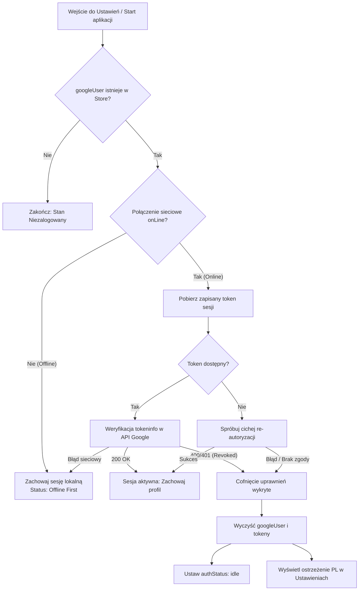

# Design: Cicha weryfikacja sesji Google i detekcja cofnięcia uprawnień w tle

## Architektura i Kontekst Techniczny

Aplikacja funkcjonuje w modelu Offline-First, zapisując profil `googleUser` w `localStorage` (poprzez middleware `persist` w bibliotece Zustand). Aby zapobiec fałszywemu poczuciu bezpieczeństwa w przypadku, gdy użytkownik odwołał dostęp do aplikacji z poziomu konta Google (`myaccount.google.com`) lub usunął konto z telefonu, wprowadzamy mechanizm cichej rewalidacji sesji w tle (Background Silent Revalidation).

### Diagram Przepływu Walidacji

## Szczegóły Komponentów

### 1. Serwis Autoryzacji (`src/services/auth/googleAuth.ts`)
- **Trwałość sesji (`AuthSession`):** Zapisywanie `AuthSession` (zawierającej `accessToken` i czas wygaśnięcia) w bezpiecznej pamięci lokalnej urządzenia (`localStorage`), dzięki czemu po restarcie aplikacji token nie ginie z pamięci operacyjnej.
- **Funkcja `validateGoogleSession()`:**
  - Zwraca `{ status: 'valid' | 'revoked' | 'offline' | 'error', error?: string }`.
  - Sprawdza `navigator.onLine` – jeśli urządzenie jest offline, nie wykonuje żadnych żądań sieciowych i zwraca `{ status: 'offline' }`.
  - Wykonuje zapytanie GET do oficjalnego punktu końcowego `https://oauth2.googleapis.com/tokeninfo?access_token=${token}`.
  - W przypadku odpowiedzi 200 OK: sesja jest w pełni ważna (`valid`).
  - W przypadku odpowiedzi 400 / 401 (`invalid_token` / `Token has been expired or revoked`):
    - W środowisku przeglądarki Web: próba jednorazowego, cichego odświeżenia sesji przez GIS (`prompt: ''`).
    - Jeśli ciche odświeżenie się nie powiedzie lub w środowisku mobilnym natywnym: kwalifikuje sesję jako odwołaną (`revoked`).
  - W przypadku błędu sieciowego (DNS, timeout): kwalifikuje jako `offline`/`error`, gwarantując, że brak łączności nie wyloguje użytkownika.

### 2. Magazyn Stanu Zustand (`src/app/lib/store.ts`)
- Dodanie akcji `validateGoogleSessionState: () => Promise<boolean>`.
- Sprawdzenie:
  - Jeśli brak `googleUser` -> zwraca `false` bez akcji.
  - Jeśli `!navigator.onLine` -> zachowuje `googleUser`, nie czyści stanu, zwraca `true`.
  - Wywołanie `validateGoogleSession()`.
  - Jeśli status to `'revoked'`:
    - Czyści stan profilu: `set({ googleUser: null, authStatus: 'idle', authError: 'Dostęp do Konta Google wygasł lub został cofnięty na Twoim koncie. Zaloguj się ponownie, aby wznowić zabezpieczanie danych.' })`.
    - Czyści tokeny w serwisie autoryzacji (`signOutFromGoogle()`).
    - Zwraca `false`.
  - Jeśli status to `'valid'`:
    - Zachowuje profil, ustawia `authStatus: 'authenticated'`, czyści `authError: null`.
    - Zwraca `true`.
  - Jeśli status to `'offline'` lub błąd sieci:
    - Zachowuje profil i status lokalny.

### 3. Zabezpieczenie Komunikatów Błędów (`src/services/auth/authErrors.ts`)
- Zapobieganie powielaniu prefiksu `Błąd logowania Google:` w sytuacji, gdy komunikat został już wcześniej sformatowany i przetłumaczony na język polski.
- Dodanie dedykowanej obsługi komunikatu cofnięcia uprawnień.

### 4. Widok Ustawień (`src/components/SettingsView.tsx`)
- W hooku `useEffect` przy wejściu na widok: jeśli `googleUser` jest zdefiniowany, uruchomienie w tle `validateGoogleSessionState()`.
- W przypadku wykrycia cofnięcia uprawnień, interfejs natychmiast przełącza się w tryb niezalogowany i prezentuje ostrzeżenie informujące o konieczności ponownego połączenia konta w celu zabezpieczenia kopii zapasowej.

